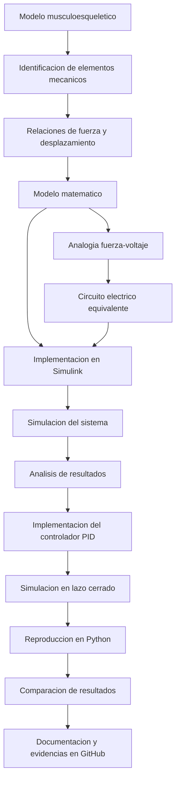

[](https://matlab.mathworks.com/open/github/v1?repo=Katherine-23212189/MSFP3)

# Práctica 3 — Modelo y control del sistema musculoesquelético

Repositorio académico de la asignatura **Modelado de Sistemas Fisiológicos**, correspondiente al programa de **Ingeniería Biomédica** del Tecnológico Nacional de México / Instituto Tecnológico de Tijuana. Esta práctica integra modelado matemático, analogías eléctricas de sistemas fisiológicos, análisis del comportamiento del sistema, diseño de controladores PID y simulación computacional.

El caso de estudio representa el **sistema musculoesquelético** mediante un modelo mecánico viscoelástico compuesto por elementos de resistencia y compliancia. A través de la analogía fuerza-voltaje se obtiene una representación eléctrica equivalente que permite estudiar el comportamiento del sistema y su respuesta ante una fuerza aplicada.

**Docente:** Dr. Paul Antonio Valle Trujillo  
**Correo:** paul.valle@tectijuana.edu.mx  
**Departamento:** Ingeniería Eléctrica y Electrónica  
**Institución:** Tecnológico Nacional de México / Instituto Tecnológico de Tijuana  
**Asignatura:** Modelado de Sistemas Fisiológicos  
**Programa:** Ingeniería Biomédica  
**Estudiante:** Katherine Coria Camacho · 23212189 · l23212189@tijuana.tecnm.mx

**Repositorio de la asignatura:** [MSFP3 — GitHub](https://github.com/Katherine-23212189/MSFP3)

**Sede:** Blvd. Alberto Limón Padilla s/n, Tijuana, C. P. 22454, B. C., México.

---

<a id="contenido"></a>
## Contenido

1. [Resumen](#resumen)
2. [Competencia y objetivos](#objetivos)
3. [Relación con el temario](#temario)
4. [Modelo físico y analogía eléctrica](#analogia)
5. [Diagrama del sistema musculoesquelético](#diagrama)
6. [Formulación matemática](#modelo)
7. [Análisis temporal y de estabilidad](#analisis)
8. [Señales de entrada y condiciones de simulación](#senales)
9. [Implementación en MATLAB y Simulink](#matlab)
10. [Control en lazo cerrado y sintonización PID](#pid)
11. [Reproducción en Python](#python)
12. [Implementación del controlador](#laboratorio)
13. [Resultados y verificación cruzada](#resultados)
14. [Flujo de trabajo](#flujo)
15. [Actividades del estudiante](#actividades)
16. [Estructura del repositorio](#estructura)
17. [Requisitos](#requisitos)
18. [Reproducibilidad y entregables](#reproducibilidad)
19. [Referencias](#referencias)

---

<a id="resumen"></a>
## Resumen

La práctica tiene como propósito **reproducir el procedimiento de modelado, análisis, simulación y control de un sistema fisiológico** mediante la representación mecánica del sistema musculoesquelético. Para ello, se utiliza un modelo viscoelástico compuesto por elementos que representan la amortiguación viscosa y las propiedades elásticas del tejido.

El modelo considera una resistencia mecánica $R$, asociada con la amortiguación viscosa inherente al tejido, y dos elementos de compliancia $C_p$ y $C_s$, que representan las propiedades elásticas del sistema. A partir de las relaciones entre fuerza, desplazamiento y velocidad, se establece el comportamiento dinámico del modelo.

Posteriormente, se utiliza la **analogía fuerza-voltaje** para obtener un circuito eléctrico equivalente, considerando la correspondencia entre fuerza y voltaje, velocidad y corriente, y desplazamiento y carga eléctrica. Esta representación permite implementar el sistema mediante herramientas computacionales como MATLAB, Simulink y Python.

Finalmente, se incorpora el análisis del comportamiento del sistema y el diseño de un controlador PID, con el propósito de estudiar y comparar las respuestas obtenidas mediante las diferentes representaciones.

**Palabras clave:** Sistema musculoesquelético; Modelado matemático; Función de transferencia; Analogía electromecánica; Control fisiológico.

[Volver al contenido](#contenido)

---

<a id="objetivos"></a>
## Competencia y objetivos

### Competencia a desarrollar

Comprender los conceptos de modelado matemático y control de sistemas fisiológicos mediante la representación de un sistema musculoesquelético. La práctica permite relacionar las propiedades mecánicas de los tejidos con circuitos eléctricos equivalentes, así como analizar su comportamiento mediante herramientas de simulación computacional.

### Objetivo general

Desarrollar el modelo matemático y la representación eléctrica equivalente de un sistema musculoesquelético, mediante la aplicación de la analogía fuerza-voltaje, para estudiar su comportamiento dinámico e implementar estrategias de control mediante simulación computacional.

### Objetivos específicos

- Identificar los elementos mecánicos que conforman el modelo del sistema musculoesquelético.
- Reconocer la función de los elementos de resistencia y compliancia dentro del modelo viscoelástico.
- Establecer las relaciones entre fuerza, desplazamiento y velocidad.
- Aplicar la analogía fuerza-voltaje para obtener el circuito eléctrico equivalente.
- Formular el modelo matemático a partir de las relaciones mecánicas del sistema.
- Implementar el modelo en MATLAB y Simulink.
- Analizar la respuesta del sistema ante la fuerza aplicada.
- Incorporar un controlador PID para estudiar el comportamiento del sistema controlado.
- Reproducir el modelo mediante Python y comparar los resultados obtenidos.
- Documentar el procedimiento, las simulaciones y los resultados en un repositorio de GitHub.

[Volver al contenido](#contenido)

---

<a id="temario"></a>
## Relación con el temario

La práctica integra contenidos correspondientes a la asignatura **Modelado de Sistemas Fisiológicos (IBF-1020)**:

| Unidad | Área | Contenidos aplicados |
|---|---|---|
| I | Sistemas de control retroalimentados | Elementos de un sistema de control, diagramas de bloques y respuesta del sistema |
| II | Modelado matemático | Representación de sistemas fisiológicos, analogías eléctricas y formulación de modelos matemáticos |
| III | Controladores | Diseño e implementación de controladores PID y análisis de la respuesta del sistema |

El enfoque combina **Ingeniería de Control, Electrónica, Ciencias de la Computación y Fisiología**, mediante el estudio de las propiedades mecánicas del sistema musculoesquelético y su representación mediante circuitos eléctricos equivalentes.

[Volver al contenido](#contenido)

---

<a id="analogia"></a>
## Modelo físico y analogía eléctrica

El sistema musculoesquelético se representa mediante un modelo mecánico viscoelástico compuesto por elementos que permiten describir las propiedades elásticas y viscosas del tejido.

El modelo considera los siguientes elementos:

- **Resistencia mecánica $R$:** representa la amortiguación viscosa inherente al tejido.
- **Compliancia paralela $C_p$:** representa uno de los elementos elásticos del modelo.
- **Compliancia en serie $C_s$:** representa el segundo elemento elástico del modelo.

El desplazamiento total del sistema se representa mediante $x(t)$ y se relaciona con los desplazamientos de las ramas del modelo:

$$
x(t)=x_1(t)+x_2(t)
$$


La fuerza total se distribuye entre las dos ramas, por lo que:

$$
F_0(t)=F_{s1}(t)+F_{s2}(t)
$$


Si el elemento de compliancia en serie $C_s$ presenta un desplazamiento $x_1(t)$, la deformación del amortiguador está asociada con la diferencia entre los desplazamientos de las ramas. Esta relación se utiliza para establecer las ecuaciones del modelo.

### Analogía fuerza-voltaje

Para obtener la representación eléctrica equivalente se utiliza la analogía fuerza-voltaje, mediante la cual se establece la siguiente correspondencia entre las variables mecánicas y eléctricas:

| Variable mecánica | Variable eléctrica | Correspondencia |
|---|---|---|
| Fuerza $F(t)$ | Voltaje $V(t)$ | Fuerza equivalente a voltaje |
| Velocidad $\frac{dx(t)}{dt}$ | Corriente $I(t)$ | Velocidad equivalente a corriente |
| Desplazamiento $x(t)$ | Carga $q(t)$ | Desplazamiento equivalente a carga |
| Amortiguador | Resistencia $R$ | Amortiguación viscosa |
| Compliancia mecánica | Capacitancia $C$ | Propiedad elástica |
| Masa | Inductancia $L$ | Inercia mecánica |

En esta analogía, las conexiones mecánicas en paralelo se representan mediante conexiones eléctricas en serie, mientras que las conexiones mecánicas en serie se representan mediante conexiones eléctricas en paralelo.

> **Alcance de la analogía:** la representación eléctrica conserva las relaciones matemáticas del modelo mecánico. Por lo tanto, los elementos eléctricos deben interpretarse de acuerdo con la correspondencia establecida entre las variables de ambos sistemas.

[Volver al contenido](#contenido)

---
<a id="diagrama"></a>
## Diagrama del sistema musculoesquelético

A continuación, se presenta el diagrama correspondiente al modelo musculoesquelético utilizado para el desarrollo de la práctica.


[Volver al contenido](#contenido)

---

<a id="modelo"></a>
## Formulación matemática

### 1. Relaciones mecánicas del sistema

El modelo se establece a partir de las relaciones entre fuerza, desplazamiento y velocidad de los elementos que conforman el sistema musculoesquelético.

El desplazamiento total del sistema se obtiene mediante la suma de los desplazamientos de las ramas:

$$
x(t)=x_1(t)+x_2(t)
$$


De manera equivalente, la fuerza aplicada se distribuye entre las dos ramas:

$$
F_0(t)=F_{s1}(t)+F_{s2}(t)
$$


### 2. Aplicación del principio de superposición

Debido a que el circuito equivalente contiene dos fuentes de voltaje, se aplica el principio de superposición para obtener la respuesta total. Se analizan por separado las contribuciones de cada fuente y posteriormente se suman.

#### Circuito 1. Se apaga la fuente $F_0(t)$

Para esta configuración, la relación entre las variables del circuito conduce a:

$$
C_p\frac{dF_{s1}(t)}{dt} = C_s\frac{d\left[F(t)-F_{s1}(t)\right]}{dt} + \frac{F(t)-F_{s1}(t)}{R}
$$ 

Aplicando la transformada de Laplace, con condiciones iniciales nulas: 

$$
C_p s F_{s1}(s) = C_s s\left[F(s)-F_{s1}(s)\right] + \frac{F(s)-F_{s1}(s)}{R}
$$


Agrupando los términos que contienen $F_{s1}(s)$:

$$
\left(C_p s+C_s s+\frac{1}{R}\right)F_{s1}(s) = \left(C_s s+\frac{1}{R}\right)F(s)
$$


Por lo tanto, la función de transferencia correspondiente a la primera contribución es:

$$
\frac{F_{s1}(s)}{F(s)} = \frac{C_s R s+1}{R(C_p+C_s)s+1}
$$


#### Circuito 2. Se apaga la fuente $F(t)$

Para la segunda configuración se considera la relación entre las fuentes:

$$
F_0(t)=\alpha F(t)
$$


La ecuación del circuito queda expresada como:

$$
-\alpha F(t) = R\frac{dx(t)}{dt} + \frac{1}{C_p+C_s}\int x(t)\,dt
$$


La contribución de la fuerza en esta rama se representa mediante:

$$
F_{s2}(t) = \frac{1}{C_p+C_s}\int x(t)\,dt
$$


Aplicando la transformada de Laplace, con condiciones iniciales nulas:

$$
-\alpha F(s) = R s X(s)+\frac{X(s)}{(C_p+C_s)s}
$$


y

$$
F_{s2}(s)=\frac{X(s)}{(C_p+C_s)s}
$$


Al despejar la relación entre la segunda contribución y la entrada, se obtiene:

$$
\frac{F_{s2}(s)}{F(s)} = -\frac{\alpha}{R(C_p+C_s)s+1}
$$


### 3. Función de transferencia del sistema

La respuesta total se obtiene sumando las contribuciones de las dos configuraciones:

$$
F_s(s)=F_{s1}(s)+F_{s2}(s)
$$


Sustituyendo las expresiones anteriores:

$$
F_s(s) = \frac{C_s R s+1}{R(C_p+C_s)s+1}F(s) - \frac{\alpha}{R(C_p+C_s)s+1}F(s)
$$


Por lo tanto, la función de transferencia del sistema musculoesquelético es:

$$
\boxed{
\frac{F_s(s)}{F(s)} = \frac{C_s R s+1-\alpha}
{R(C_p+C_s)s+1}
}
$$


[Volver al contenido](#contenido)

---

---

<a id="analisis"></a>
## Análisis temporal y de estabilidad

El análisis del sistema permite estudiar su comportamiento dinámico a partir de las ecuaciones matemáticas obtenidas y de las respuestas generadas durante la simulación.

### 1. Comportamiento dinámico

El sistema musculoesquelético presenta un comportamiento viscoelástico debido a la combinación de elementos elásticos y viscosos.

Los elementos de compliancia permiten representar la deformación elástica del tejido, mientras que el elemento de resistencia representa la amortiguación viscosa inherente al sistema.

La función de transferencia obtenida es:

$$
\frac{F_s(s)}{F(s)} = \frac{C_s R s+1-\alpha} {R(C_p+C_s)s+1}
$$


La combinación de estos elementos determina la respuesta del modelo ante la fuerza aplicada.

### 2. Error en estado estacionario

Para una entrada escalón unitario, el error en estado estacionario se obtiene mediante el teorema del valor final:

$$
e_{ss} = \lim_{s\to 0}
s\left[
\frac{1}{s}
\left(
1-\frac{F_s(s)}{F(s)}
\right)
\right]
$$


Sustituyendo la función de transferencia del sistema:

$$
e_{ss} =
\lim_{s\to 0}
\left[
1-
\frac{C_s R s+1-\alpha}
{R(C_p+C_s)s+1}
\right]
$$


Por lo tanto:

$$
\boxed{e_{ss}=\alpha}
$$


### 3. Estabilidad en lazo abierto

La ecuación característica se obtiene a partir del denominador de la función de transferencia:

$$
R(C_p+C_s)s+1=0
$$


El polo del sistema está dado por:

$$
\lambda=-\frac{1}{R(C_p+C_s)}
$$


Para valores positivos de $R$, $C_p$ y $C_s$, el polo se encuentra en el semiplano izquierdo del plano complejo. Por lo tanto, el sistema es estable en lazo abierto.

### 4. Predicción previa

Antes de ejecutar las simulaciones, se recomienda elaborar un bosquejo cualitativo de la respuesta esperada del sistema ante la fuerza aplicada.

Posteriormente, se comparará dicho comportamiento con las respuestas obtenidas mediante MATLAB, Simulink y Python.

[Volver al contenido](#contenido)

---

---

<a id="senales"></a>
## Señales de entrada y condiciones de simulación

La simulación del sistema se realiza mediante la aplicación de una fuerza de entrada $F_0(t)$, utilizada para estudiar la respuesta del modelo musculoesquelético.

La entrada se define mediante una señal de fuerza aplicada durante un intervalo determinado.

El vector temporal y las condiciones de simulación se establecen de acuerdo con los parámetros utilizados en el modelo computacional.

| Variable | Descripción |
|---|---|
| $F_0(t)$ | Fuerza aplicada al sistema |
| $x(t)$ | Desplazamiento del elemento de compliancia paralela |
| $x_1(t)$ | Desplazamiento del elemento de compliancia en serie |
| $R$ | Elemento de amortiguación viscosa |
| $C_p$ | Elemento de compliancia paralela |
| $C_s$ | Elemento de compliancia en serie |

Las condiciones iniciales y los parámetros utilizados deben mantenerse consistentes entre las diferentes implementaciones para facilitar la comparación de resultados.

[Volver al contenido](#contenido)

---

<a id="matlab"></a>
## Implementación en MATLAB y Simulink

El modelo matemático del sistema musculoesquelético se implementa mediante Simulink, utilizando los bloques necesarios para representar las relaciones diferenciales del sistema.

La implementación permite observar el comportamiento de las variables del modelo y estudiar su respuesta ante la fuerza aplicada.

### Ejecución desde el modelo de Simulink

El archivo de Simulink contiene la representación del sistema musculoesquelético y permite ejecutar la simulación a partir de los parámetros establecidos.

Durante la implementación se deben identificar las siguientes variables:

1. **Entrada:** fuerza aplicada $F_0(t)$.
2. **Variables internas:** desplazamientos y velocidades de los elementos mecánicos.
3. **Salida:** respuesta del sistema musculoesquelético.

El modelo debe conservar las relaciones entre los elementos mecánicos y las condiciones de equilibrio utilizadas durante la formulación matemática.

[Volver al contenido](#contenido)

---

<a id="pid"></a>
## Control en lazo cerrado y sintonización PID

### 1. Retroalimentación negativa

Para estudiar el comportamiento controlado del sistema se incorpora un controlador PID mediante una estructura de retroalimentación negativa.

La señal de error se obtiene a partir de la diferencia entre la referencia y la salida del sistema:

$$
e(t)=r(t)-y(t)
$$


Donde:

- $r(t)$ representa la señal de referencia.
- $y(t)$ representa la salida del sistema.
- $e(t)$ representa el error entre la referencia y la salida.

### 2. Controlador PID

La ley de control de un controlador PID ideal está dada por:

$$
u(t)=k_Pe(t)+k_I\int_0^t e(\tau)\,d\tau+k_D\frac{de(t)}{dt}
$$


Donde:

- $k_P$ corresponde a la ganancia proporcional.
- $k_I$ corresponde a la ganancia integral.
- $k_D$ corresponde a la ganancia derivativa.

En el dominio de Laplace, la función de transferencia del controlador se expresa como:

$$
K(s)=k_P+\frac{k_I}{s}+k_Ds
$$


### 3. Sintonización

La sintonización del controlador se realiza mediante las herramientas de MATLAB y Simulink, ajustando las ganancias del controlador de acuerdo con el comportamiento esperado del sistema.

Se debe conservar la evidencia de la configuración del controlador PID y de las respuestas obtenidas durante la simulación.

[Volver al contenido](#contenido)

---

<a id="python"></a>
## Reproducción en Python

La implementación en Python permite reproducir el modelo matemático del sistema musculoesquelético mediante una herramienta computacional independiente.

El programa se ejecuta mediante **Visual Studio Code**, utilizando las bibliotecas necesarias para realizar los cálculos numéricos y generar las gráficas correspondientes.

Se deben identificar y explicar los siguientes apartados:

1. Definición de las constantes y parámetros del modelo.
2. Definición del vector temporal.
3. Construcción de la señal de fuerza aplicada.
4. Definición de las funciones correspondientes al modelo.
5. Cálculo de la respuesta del sistema.
6. Implementación del controlador PID.
7. Simulación de la respuesta del sistema controlado.
8. Generación y almacenamiento de las gráficas.

Los resultados obtenidos mediante Python deben compararse con los resultados de MATLAB y Simulink, procurando mantener las mismas condiciones iniciales, parámetros y señales de entrada.

[Volver al contenido](#contenido)

---

<a id="laboratorio"></a>
## Implementación del controlador

El controlador PID se incorpora al modelo para analizar la respuesta del sistema musculoesquelético bajo condiciones de retroalimentación.

La implementación se realiza mediante el modelo computacional, utilizando los parámetros de control obtenidos durante el proceso de sintonización.

### 1. Configuración del controlador

Se deben identificar los parámetros proporcionales, integrales y derivativos utilizados en el controlador:

| Parámetro | Descripción |
|---|---|
| $k_P$ | Ganancia proporcional |
| $k_I$ | Ganancia integral |
| $k_D$ | Ganancia derivativa |

### 2. Implementación en Simulink

El controlador se incorpora al diagrama de bloques del sistema, estableciendo la conexión de retroalimentación negativa entre la salida y la entrada de referencia.

Se debe verificar que las señales estén conectadas correctamente y que la salida del controlador actúe sobre el modelo de acuerdo con la estructura definida.

### 3. Comparación de resultados

La respuesta del sistema controlado se compara con la respuesta obtenida en lazo abierto, identificando los cambios en el comportamiento dinámico ocasionados por la incorporación del controlador PID.

[Volver al contenido](#contenido)

---

<a id="resultados"></a>
## Resultados y verificación cruzada

Los resultados de la práctica permiten comparar el comportamiento del modelo musculoesquelético mediante sus diferentes implementaciones computacionales.

Se deben conservar las gráficas y capturas correspondientes a cada etapa del desarrollo.

### Evidencias de la práctica

| Entregable | Descripción |
|---|---|
| Análisis matemático | Desarrollo de las ecuaciones y representación del modelo |
| Diagrama del sistema | Representación del modelo musculoesquelético |
| Simulink | Archivo del modelo computacional |
| Cuaderno MATLAB | Archivo original de la práctica |
| PDF del cuaderno | Exportación del cuaderno MATLAB |
| Imágenes del cuaderno | Capturas de las gráficas y resultados |
| Controlador PID | Imagen de la configuración del controlador |
| Código Python | Implementación del modelo en Visual Studio Code |
| Imágenes de Python | Capturas del código y resultados obtenidos |

### Aspectos para discutir

- Correspondencia entre el modelo mecánico y su representación eléctrica equivalente.
- Comportamiento de los elementos de resistencia y compliancia.
- Relación entre fuerza aplicada, desplazamiento y velocidad.
- Respuesta del sistema ante la fuerza de entrada.
- Diferencias entre las respuestas obtenidas mediante MATLAB y Python.
- Efecto de la incorporación del controlador PID.
- Consistencia entre el modelo matemático y las simulaciones.

Los resultados deben acompañarse de una interpretación del comportamiento observado, identificando las diferencias entre las representaciones y las posibles causas de discrepancia.

[Volver al contenido](#contenido)

---

<a id="flujo"></a>
## Flujo de trabajo



El procedimiento integra la formulación matemática, la representación eléctrica equivalente, la simulación computacional y el análisis del comportamiento del sistema controlado.

[Volver al contenido](#contenido)

---

<a id="actividades"></a>
## Actividades del estudiante

La práctica sigue una secuencia de **modelado, implementación, simulación y documentación** del sistema musculoesquelético.

### Etapa 1. Formulación y análisis

- [ ] Identificar los elementos mecánicos que conforman el modelo.
- [ ] Identificar la función del elemento de resistencia $R$.
- [ ] Identificar los elementos de compliancia $C_p$ y $C_s$.
- [ ] Establecer las relaciones entre fuerza, desplazamiento y velocidad.
- [ ] Obtener las ecuaciones matemáticas del sistema.
- [ ] Aplicar la analogía fuerza-voltaje.
- [ ] Elaborar el diagrama del circuito eléctrico equivalente.

### Etapa 2. Simulación del sistema

- [ ] Implementar el modelo en Simulink.
- [ ] Configurar los parámetros del sistema.
- [ ] Definir la fuerza de entrada.
- [ ] Ejecutar la simulación.
- [ ] Obtener las gráficas correspondientes.
- [ ] Analizar el comportamiento de las variables del sistema.

### Etapa 3. Diseño y comprobación del controlador

- [ ] Incorporar el controlador PID.
- [ ] Configurar las ganancias del controlador.
- [ ] Implementar la retroalimentación negativa.
- [ ] Ejecutar la simulación en lazo cerrado.
- [ ] Comparar la respuesta del sistema controlado con la respuesta en lazo abierto.
- [ ] Guardar la imagen correspondiente al controlador PID.

### Etapa 4. Reproducción y documentación

- [ ] Reproducir el modelo mediante Python.
- [ ] Ejecutar el código desde Visual Studio Code.
- [ ] Obtener las gráficas correspondientes.
- [ ] Comparar los resultados de MATLAB y Python.
- [ ] Exportar el cuaderno MATLAB a formato PDF.
- [ ] Guardar las imágenes del cuaderno.
- [ ] Guardar las imágenes del código Python y sus resultados.
- [ ] Organizar los archivos y evidencias en GitHub.
- [ ] Completar el README con la descripción del procedimiento y los resultados.

[Volver al contenido](#contenido)

---

<a id="estructura"></a>
## Estructura del repositorio

Una organización **sugerida** para la entrega, compatible con los archivos solicitados, es:

```text
.
├── README.md
├── Analisis_Matematico.pdf
│   └── Diagrama del sistema musculoesquelético
├── Sistema_Practica3.slx
├── Coria23212189P3.mlx
├── Coria23212189P3.pdf
├── Imagenes_Cuaderno/
│   ├── resultado_1.png
│   ├── resultado_2.png
│   └── ...
├── PID/
│   └── controlador_PID.png
├── Coria23212189P3.py
└── Imagenes_Python/
    ├── codigo_python.png
    ├── resultado_1.png
    ├── resultado_2.png
    └── ...
```

**Criterio de nombres:** los nombres de los archivos de MATLAB, Python y las carpetas de evidencias son sugerencias de organización. El archivo `Sistema_Practica3.slx` conserva el nombre del modelo de Simulink proporcionado para la práctica. Si se utilizan otros nombres o subcarpetas, se deben actualizar las rutas correspondientes del README.

[Volver al contenido](#contenido)

---

<a id="requisitos"></a>
## Requisitos

### Software

- **MATLAB** para el desarrollo y ejecución del cuaderno computacional.
- **Simulink** para la implementación del modelo y del controlador.
- **Python** para reproducir el modelo matemático.
- **Visual Studio Code** para ejecutar y modificar el código Python.
- Las bibliotecas de Python utilizadas por el programa de referencia.
- **Git y GitHub** para organizar y presentar el repositorio de la práctica.

### Archivos de trabajo

- Archivo del modelo de Simulink.
- Cuaderno computacional de MATLAB.
- Código de implementación en Python.
- Archivo con el análisis matemático y el diagrama del sistema.
- Imágenes y capturas de los resultados.
- Imagen de la configuración del controlador PID.

[Volver al contenido](#contenido)

---

<a id="reproducibilidad"></a>
## Reproducibilidad y entregables

### Secuencia de reproducción

1. Consultar el [repositorio general de la asignatura](https://github.com/DrPaulValle/MSF-IBF1020) y revisar los archivos proporcionados para la práctica.
2. Identificar los elementos mecánicos que conforman el modelo musculoesquelético.
3. Establecer las relaciones entre fuerza, desplazamiento y velocidad.
4. Desarrollar el análisis matemático del sistema.
5. Obtener la representación eléctrica equivalente mediante la analogía fuerza-voltaje.
6. Implementar el modelo en Simulink.
7. Ejecutar la simulación y analizar las respuestas obtenidas.
8. Incorporar el controlador PID y realizar la simulación en lazo cerrado.
9. Reproducir el modelo mediante Python en Visual Studio Code.
10. Comparar los resultados obtenidos mediante MATLAB y Python.
11. Guardar las gráficas, capturas y evidencias correspondientes.
12. Organizar los archivos y publicar el repositorio en GitHub.

### Resultados mínimos esperados

| Entregable | Evidencia solicitada |
|---|---|
| Análisis matemático | Archivo con el desarrollo matemático del modelo |
| Diagrama del sistema | Representación del modelo musculoesquelético |
| Modelo Simulink | Archivo `.slx` del sistema |
| Cuaderno MATLAB | Archivo original `.mlx` |
| Exportación MATLAB | Archivo `.pdf` del cuaderno |
| Imágenes del cuaderno | Capturas de las gráficas y resultados |
| Controlador PID | Imagen de la configuración del controlador |
| Código Python | Archivo `.py` ejecutable desde Visual Studio Code |
| Imágenes de Python | Capturas del código y resultados |

### Criterios de presentación académica

En el README final debe distinguirse entre el desarrollo matemático, las implementaciones computacionales y los resultados obtenidos durante la simulación.

La ejecución de los programas y la generación de gráficas deben acompañarse de una explicación del comportamiento del modelo musculoesquelético y de la correspondencia entre sus representaciones mecánica y eléctrica.

[Volver al contenido](#contenido)

---

<a id="referencias"></a>
## Referencias

[1] M. C. Khoo, *Physiological Control Systems: Analysis, Simulation, and Estimation*, 2nd ed., IEEE Press, 2018.

[2] F. C. Hoppensteadt y C. S. Peskin, *Modeling and Simulation in Medicine and the Life Sciences*, Springer.

[3] J. E. Hall, *Guyton and Hall Textbook of Medical Physiology*, 14th ed., Elsevier, 2021.

[4] K. Ogata, *Ingeniería de Control Moderna*, 5.ª ed., Pearson Educación, 2010.

[5] N. S. Nise, *Control Systems Engineering*, 8th ed., John Wiley & Sons, 2020.

[6] P. A. Valle, *Syllabus para Modelado de Sistemas Fisiológicos*, Tecnológico Nacional de México / Instituto Tecnológico de Tijuana, Tijuana, B. C., México, 2026. Disponible en: https://biomath.xyz/course/

[7] Tecnológico Nacional de México, *Programa de estudio de la asignatura Modelado de Sistemas Fisiológicos, IBF-1020*.

---

## Uso académico

Este repositorio se utiliza como evidencia de la práctica de **Modelo y control del sistema musculoesquelético**, correspondiente a la asignatura Modelado de Sistemas Fisiológicos. Su finalidad es desarrollar habilidades de modelado matemático, interpretación de sistemas fisiológicos, aplicación de analogías eléctricas, simulación computacional y análisis de sistemas de control.

El procedimiento se fundamenta en los materiales proporcionados para la práctica. Cualquier modificación de parámetros, estructura del modelo o procedimiento debe identificarse y justificarse.
